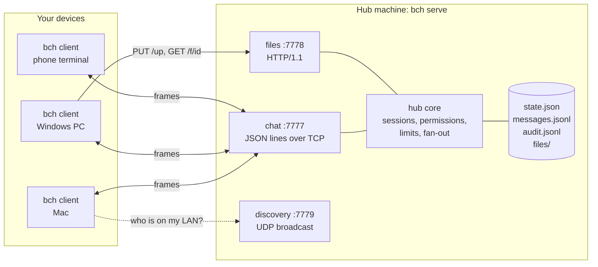
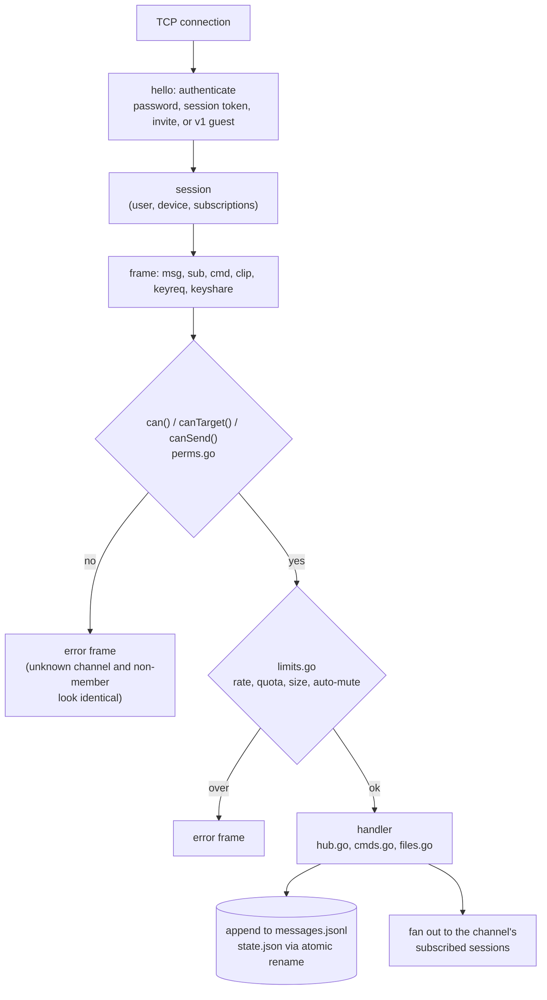
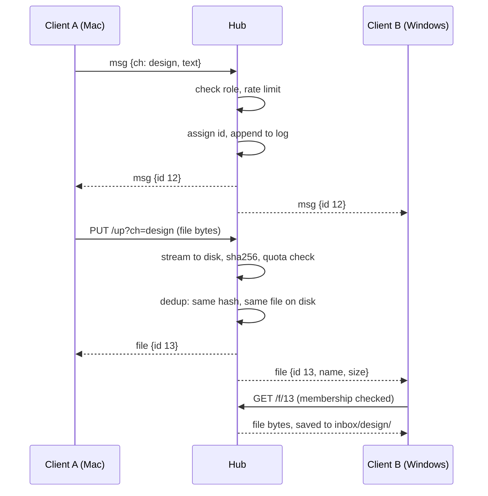
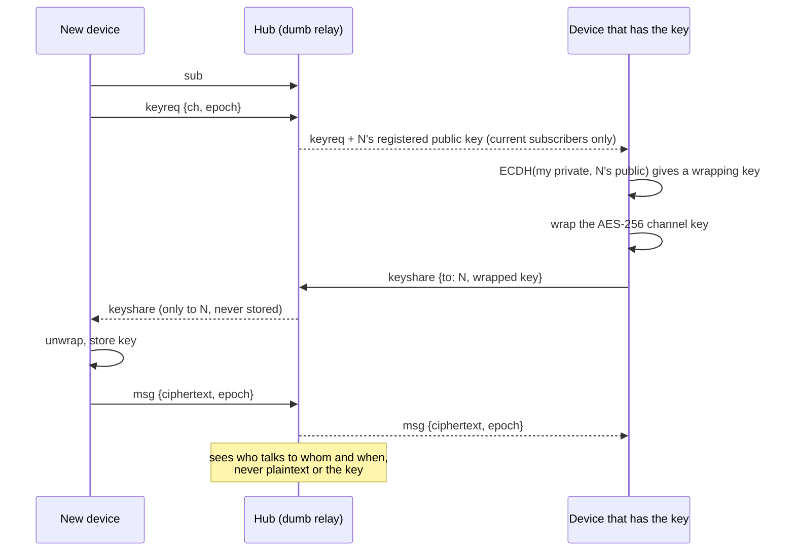
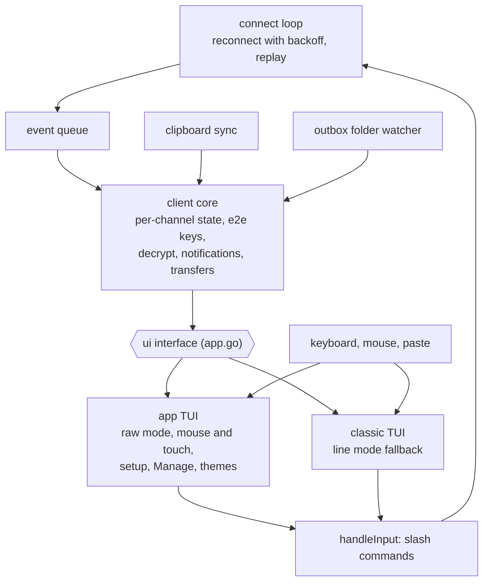

# backchannel (`bch`)

> A small, self-hosted relay for moving text, files, and clipboard data between trusted
> devices and groups. No cloud account. No browser. One binary.

A private, self-hosted set of chat channels for your own machines and a small group of
people you trust. Type text, paste your clipboard, or drag a file into the terminal — it
shows up on every other device in that channel and lands in their `inbox` folder. Your
clipboard can follow you from your Mac to your Windows PC. Channels can self-destruct,
or be end-to-end encrypted so even the hub can't read them.

One static ~6 MB binary (Go, standard library only — not even `net/http`). Idles at a few
MB of RAM with zero CPU. Runs on macOS, Windows and Linux. No cloud, no browser, no
runtime to install. Formerly `dropchan`; v2 adds accounts, many channels on one port,
roles and moderation, per-account abuse limits, clipboard sync, self-destruct channels
and optional end-to-end encryption.

```
┌ mac ─────────────────────────────────────┐        ┌ windows work PC ─────────────────────────┐
│ $ bch serve                  (the hub)   │        │ > bch                                     │
│ $ bch -user ayush            (client)    │◄──────►│  10:42 ayush  #12 meeting is 3pm          │
│  10:42 ayush  #12 meeting is 3pm         │  TCP   │  10:43 ayush  #13 📎 spec.pdf (1.2 MB)     │
│  10:43 ayush  #13 📎 spec.pdf (1.2 MB)    │  7777  │  — saved ~\backchannel\inbox\design\spec… │
│  — 📋 clipboard synced (42 B)            │  HTTP  │  — 📋 clipboard ← mac (42 B)              │
│  1:#general  2:#design(1)  3:#ops        │  7778  │  1:#general  2:#design  3:#ops(3)         │
│  connected · ayush@hub · #design (owner) │        │  connected · ayush@hub · #design (owner)  │
│ > _                                      │        │ > _                                       │
└──────────────────────────────────────────┘        └───────────────────────────────────────────┘
```

## Documentation map

| Read | When you want to |
|---|---|
| this file | install, connect two machines, everyday use |
| [ADMIN-GUIDE.md](ADMIN-GUIDE.md) | run a hub for other people: roles, invites, moderation, limits, self-destruct channels, audit |
| [PUBLIC-SERVER.md](PUBLIC-SERVER.md) | put the hub on the internet safely (TLS, pinning, VPS, firewall, backups) |
| [CLIPBOARD.md](CLIPBOARD.md) | clipboard sync: how it works, what it never does, platform notes |
| [ENCRYPTION.md](ENCRYPTION.md) | end-to-end encrypted channels: how the key exchange works, what it protects and what it doesn't |
| [PROTOCOL.md](PROTOCOL.md) | script against the hub (JSON frames, HTTP upload/download, curl) |
| [WINDOWS-SETUP.md](WINDOWS-SETUP.md) | step-by-step Windows client install |
| [PHASE2-DESIGN.md](PHASE2-DESIGN.md) | the design spec and the reasoning behind it |
| [CONTRIBUTING.md](CONTRIBUTING.md) | code, tests, docs, and pull-request expectations |
| [LICENSE](LICENSE) | the terms (MIT) |
| [AGENTS.md](AGENTS.md) | concise instructions for coding agents working in this repository |

The public site lives in `site/`; see [CONTRIBUTING.md](CONTRIBUTING.md#the-site) to build it.

## Architecture

backchannel is a star: one **hub** process owns all state, and every **client** keeps one
persistent connection to it. Clients never talk to each other. Everything below is one
Go package built from the standard library.

### What runs where



Chat frames and file bytes use separate ports so a large upload never delays a message.
Both ports check the same session token against the same account table.

### Inside the hub

Every frame, from any connection, takes the same path:



Three frame types skip the log: `clip` goes only to the sender's other sessions,
`keyshare` only to the one device it names, `keyreq` only to the channel's current
subscribers. The hub decides *whether* to relay them (membership) and never reads the
payload.

### A message and a file



A reconnecting client sends `sub` with the last message id it saw, and the hub replays
exactly the gap, including deletions as tombstones.

### How end-to-end channels exchange a key

In a channel created with `e2e=on` the hub relays ciphertext and wrapped keys. It never
has the channel key. The full threat model is in [ENCRYPTION.md](ENCRYPTION.md).



### Inside the client



Both interfaces sit behind one `ui` interface, so the client core never knows which one
it is driving. Every screen in the app TUI (Manage, the command list, forms) ends in an
ordinary slash command, so the hub checks the same permissions whichever way you got there.

### Where the code is

| Area | Files |
|---|---|
| Wire types | `proto.go` |
| Hub | `hub.go`, `cmds.go`, `files.go`, `perms.go`, `limits.go`, `store.go`, `auth.go`, `tls.go`, `http_min.go`, `discovery.go` |
| Client | `client.go`, `client_cmds.go`, `clipboard*.go`, `notify*.go`, `e2e_client.go` |
| Encryption primitives | `e2e.go` |
| App TUI | `app*.go`, `input.go`, `editor.go`, `canvas.go`, `theme.go`, `catalog.go`, `rawterm_*.go` |
| Classic TUI | `tui.go`, `term_*.go` |

`CLAUDE.md` has the per-file description and the rules that keep these parts honest.

## Design in one table

| Concern | Decision | Why |
|---|---|---|
| Topology | One **hub** process (star). Clients keep a persistent TCP connection. | Persistence + history like an IRC bouncer; no NAT hole-punching; the hub is the single source of truth. |
| Channels | Many channels over **one port**; each connection has a subscription set. | A port identifies a process, not a conversation. One process, one TLS identity, one service file. |
| Chat protocol | Newline-delimited JSON over raw TCP (`:7777`), `TCP_NODELAY`. | Simplest thing that is instant. A message is one `write()`. |
| Files | Hand-rolled HTTP/1.1 (`PUT /up`, `GET /f/<id>` on `:7778`), streamed to disk, hashed on the way in. | Files move at line speed without blocking chat; `curl` works; skipping `net/http` keeps the binary small. |
| Accounts | Username + password (PBKDF2-SHA256, 600k rounds). Clients keep a **revocable session token**, never the password. | A stolen laptop leaks one session you can revoke, not the password. |
| Roles | Server: owner › admin › user › guest. Per channel: owner › admin › mod › member › readonly. One `can()` function decides everything. | Access control scattered through handlers is where chat systems leak. |
| Secrecy | Channels are unlisted. "No such channel" and "not a member" are the **same bytes**. Invite codes are the only way in. | You cannot confirm a channel exists unless you are in it. |
| Abuse control | Limits keyed by **account**, at three levels (server → channel → user): message rate, upload rate, storage quota, size caps, auto-mute for flooding. Identical files stored once. | Sending the same file 1000 times costs one copy on disk and then hits the upload rate limit. |
| History | Append-only `messages.jsonl`, replayed per channel from the last id a client saw. Deletions are tombstones. | Reconnect after Wi-Fi drop shows exactly the gap; offline clients learn about deletions. |
| Self-destruct | Per-channel `expire` (10m … weeks). Hub removes messages and their files on a 15 s sweep and tells clients, which also expire locally. | Short-lived rooms without anyone doing housekeeping. |
| End-to-end encryption | Optional per channel (`e2e=on` at creation). Each device has its own X25519 identity; the channel's AES-256 key is generated client-side, wrapped to a device's public key, and relayed by the hub — which never sees the key or plaintext. | Some rooms shouldn't be readable by the hub operator, at all. See ENCRYPTION.md. |
| Clipboard sync | `clip` frames relayed only to *your other devices*, never stored or replayed. Opt-in per device. | Clipboards hold passwords. |
| Storage | One `state.json` (atomic rename) + `messages.jsonl` + `audit.jsonl`. No database. | Stays stdlib-only, cross-compiles in one command, is `grep`-able. Fine for hundreds of users. |
| Public hub | `bch serve -public`: TLS 1.3 with a self-signed cert, clients **pin the fingerprint** (SSH-style). | No domain or CA needed; a MITM is detected. See PUBLIC-SERVER.md. |
| Discovery | UDP broadcast `:7779`. | Zero-config on the same LAN. |
| UI | Full-screen raw-mode TUI with mouse and touch input, a setup flow, a command list, Manage screens and themes. Falls back to the original line-mode TUI (`-classic`) when the terminal can't do raw mode. | One parser for every OS: Windows 10 1809+ consoles speak the same escape sequences as macOS and Linux terminals. Every screen is a front for an existing slash command, so nothing behaves differently between the two. |

Data layout: `~/backchannel/{config.json, inbox/<channel>/, outbox/, outbox/<channel>/, outbox/sent/}` and on
the hub machine `~/backchannel/hub/{state.json, messages.jsonl, audit.jsonl, files/, cert.pem, key.pem}`.
Override with `BCH_DIR` or `-dir`.

## Build

```sh
# needs Go 1.24+ (brew install go / winget install GoLang.Go)
cd code
go build -o bch .        # for this machine
chmod +x build.sh         # only needed if the checkout lost executable bits
./build.sh                # → six macOS, Windows, and Linux arm64/amd64 binaries in dist/
go test ./...            # permissions matrix, secrecy rule, moderation, files, expiry, guests, e2e crypto + key exchange
```

## Setup (5 minutes)

**1. Start the hub** on the machine that is always on (your Mac, or a VPS — see PUBLIC-SERVER.md):
```sh
cp dist/bch-darwin-arm64 /usr/local/bin/bch && chmod +x /usr/local/bin/bch
bch serve
```
```
backchannel hub 2.0.0
  chat :7777   files :7778   discovery udp :7779   tls: false
  ★ owner account created —  username: owner   password: k3J9mQvT2xPb7n
    (shown once; change it with /passwd inside the app; recover with `bch serve -reset-owner`)
  guest access: off (accounts only)
  connect with:
    bch -hub 192.168.1.20:7777 -user owner
```
Leave it running (or install it as a service, below).

**2. Connect from the same machine** in a second tab:
```sh
bch
```
The first run opens **setup**: pick the hub (hubs on your network are listed), name this
device, sign in (`owner` and the password above), pick a theme. You are in `#general`.
Change the password now: `/passwd`. `bch setup` goes through it again later; the flags
below still work and skip the steps they answer:
```sh
bch -hub 192.168.1.20 -user owner
```

**3. Connect from the Windows PC** (details in WINDOWS-SETUP.md):
```powershell
bch -hub 192.168.1.20 -user owner -name work
```
Same account, second device. After the first run just type `bch` — the session is
remembered in `config.json`. Both devices see the same channels and the same unread counts.

**4. Bring in another person** (from inside the app, in the channel you want them in):
```
/invite
— invite code:  k7Qz-9mPd2   (#general · uses: 1 use · expires: 3d · role: member)
—   new person:      bch -hub <hub address> -invite k7Qz-9mPd2 -user THEIR_NAME
—   existing member: /join k7Qz-9mPd2
```
Send them the hub address and the code. They pick their own username and password.
Everything about running a hub for other people — roles, bans, limits, settings — is in
**ADMIN-GUIDE.md**.

## Using it

| Action | How |
|---|---|
| Send text | type, Enter |
| Send a file | drag it into the terminal window, Enter — or `/send C:\path\file.png` — or drop it in `~/backchannel/outbox` (→ active channel) or `~/backchannel/outbox/<channel>/` |
| Fetch a file that didn't auto-download | `/get 13` (or `/get` for the latest in this channel) |
| Open this channel's inbox folder | `/open` · the folder a saved file is in: `/open 13` |
| Switch channel | `/1` … `/9`, `/n` / `/p`, `/c design`, or just `/design` |
| List your channels | `/channels` |
| Join with an invite code | `/join k7Qz-9mPd2` |
| Who is online here | `/who` · all members and roles: `/members` |
| Clipboard → channel | `/paste` |
| Message → clipboard | `/copy 12` (or `/copy` for the latest) |
| Keep clipboards in sync across my devices | `/clip on` on each device (see below) |
| Mention someone | `@name` — rings their terminal bell even in a background channel |
| Delete my message | `/del 12` |
| Desktop notifications | `/notify desktop` (bell plus a system notification; `/notify test` to try it) |
| Quieter | `/notify off` |
| Leave | `/quit` or Ctrl-C |
| Everything | `/help` |

The **channel list** on the left shows unread counts and which channels are encrypted. Files
auto-download (≤ 50 MB, `-auto N` to change) in the channel you are looking at; for a channel
you want to receive files from in the background, `/watch design`.

### The interface

| Want to | Keyboard | Mouse / touch |
|---|---|---|
| Find a command | type `/` — matching commands appear above the input; ↑↓ pick, Tab completes | tap a suggestion |
| Everything in one list | Ctrl-K, then type to filter | **⌘ Commands** in the bottom bar |
| Switch channel | Alt+1…9, Ctrl-N / Ctrl-P, Ctrl-O for a list | tap it in the channel list, or **≡** on a narrow window |
| Read back | PgUp / PgDn; End or Esc returns to the latest | wheel or swipe in the messages |
| Channels, people, invites, devices, files, look | F2 or `/manage` | **⚙ Manage** |
| Change the theme | `/theme amber` (`/theme` alone lists them) | Manage → Appearance |
| Keys | F1 | **? Help** |
| New line in a message | Alt+Enter | — |
| Complete a name or channel | Tab after `@mi`, `/kick s`, `/c de`, `/watch …`; Tab again for the next match | — |
| Find in this channel | Ctrl-F or `/find TEXT`; Enter/↑ older match, ↓ newer, Esc closes | **⌘ Commands** → Find |
| Fetch or open a file | `/get 13`, then `/open 13` | tap the file line: downloads it, or opens its folder once saved |
| Check the devices in an e2e channel | `/verify` with no name | Manage → Security → Verify devices |

Manage runs the same slash commands you would type and shows the exact command before it
runs, so it works for every role and the hub checks it like any other command. Password
prompts (`/passwd`, `/login`) hide what you type.

A message you started typing stays with its channel: switch away and back and it is still
in the input. Uploads and downloads show their progress in the status line.

**Notifications.** `/notify on` (the default) rings the terminal bell for a mention or a
message in another channel. `/notify desktop` adds a system notification for those, and for
any message while the terminal window is in the background (the app asks the terminal for
focus reports; terminals that don't send them are treated as always focused). It uses
`osascript` on macOS, `notify-send` on Linux (from libnotify) and a Windows PowerShell toast
on Windows 10/11. In an end-to-end encrypted channel the notification only says that a
message arrived: notification centres keep a history and show it on the lock screen, so
the text stays inside bch. At most one notification every 4 seconds.

The layout follows the window: channel list and a "here now" panel on wide windows, the
channel list alone on medium ones, messages only (with **≡** for channels) on a phone-sized
terminal. Themes: `site-dark` (default), `site-light`, `phosphor`, `amber`, `telex`,
`blueprint`, and `terminal`, which uses your terminal's own colours (also the default when
`NO_COLOR` is set). Colours are 24-bit where the terminal says it supports them, 256 otherwise.

With mouse input on, most terminals select text when you hold **Shift** while dragging;
`/mouse off` turns mouse handling off entirely. The original line-mode interface is still
there: `bch -classic`, `BCH_CLASSIC=1`, or `"ui": "classic"` in `config.json`. It is also
used automatically when stdin isn't a terminal or the console can't do raw mode.

### Clipboard sync

```
/clip on          # on each of your devices
```
Copy something on the Mac; a moment later it is in the Windows clipboard, and vice versa.
It only ever goes to devices logged in as **you**, the hub never stores it, and it is off
until you turn it on. `/clip push` sends the current clipboard once without turning sync
on; `/clip pull` applies the last one received. Text only. Full details, including what
it costs and how loop-prevention works, in **CLIPBOARD.md**.

### Self-destruct channels

```
/create burn a room that forgets expire=1h
/settings expire=10m        # in an existing channel (channel admin+)
```
Messages older than the expiry disappear from the hub (and their files from the hub's
disk) on a 15-second sweep, and from every open client — even offline ones, which expire
locally by timestamp. Files the app auto-downloaded from such a channel are removed from
your inbox when their message expires; anything you moved elsewhere is yours. The status
bar shows `🔥 10m` while you are in one. Values: `10m`, `2h`, `7d`, `1w`, `off`.

### End-to-end encrypted channels

```
/create incident-room e2e=on
```
The hub only ever sees ciphertext in a channel created this way — not the messages, not
the file contents or names, not the key. A newly joined device asks for the key
automatically and gets it from any other device that's online and already holds it;
`/e2e status` shows whether yours does. `/e2e rotate` (mod+) issues a new key, which also
happens automatically after a `/kick` or `/ban` in such a channel. `/verify` lists every
device online in the channel with its key fingerprint; once you have compared one with its
owner, mark it, and it shows as verified on this device from then on. Full design, the key
exchange, and what this does and doesn't protect against: **ENCRYPTION.md**.

### From scripts / other terminals (no TUI)

```sh
bch send "deploy is done"                # text → your last active channel
bch send -ch ops ~/Desktop/shot.png      # file → #ops
pbpaste | bch send -ch notes             # stdin → channel
bch discover                             # list hubs on this LAN
```
The first `bch send` on a machine asks for your password once; the session is saved.

## Public hub (people outside your network)

```sh
bch serve -public          # TLS + fingerprint pinning + stricter rate limits
#   fingerprint: DC:CB:53:…
#   (public) bch -hub tls://<YOUR-PUBLIC-IP>:7777 -user NAME -fingerprint DC:CB:53:…
```
Clients connect with `tls://` and ideally `-fingerprint`; without it the first certificate
seen is pinned and any later change is refused. VPS deployment, systemd unit, firewall,
backups and the threat model are in **PUBLIC-SERVER.md**.

## Different networks (home ↔ office)

The hub needs to be reachable from both machines. Pick one:

1. **Tailscale (recommended for your own devices).** Install on both machines, log in. Use
   the hub's Tailscale IP: `bch -hub 100.101.102.103 -user you`. WireGuard-encrypted,
   direct peer-to-peer, works through corporate NAT with no port forwarding. Any similar
   overlay (ZeroTier, NetBird, WireGuard) works the same way.
2. **Tiny VPS with `-public`.** Run `bch serve -public` on a $4 VM, open TCP 7777–7778.
   TLS + pinning + accounts make this safe for a group. See PUBLIC-SERVER.md.
3. **SSH tunnel** if the office allows outbound SSH to a home box:
   `ssh -N -L 7777:localhost:7777 -L 7778:localhost:7778 user@home` then `-hub 127.0.0.1`.

The client reconnects automatically with backoff and replays anything it missed, so
lid-close / VPN flap / office Wi-Fi are all fine.

## Run it as a service

**macOS hub (launchd):** edit the path in `code/service/com.backchannel.hub.plist`, then
```sh
cp code/service/com.backchannel.hub.plist ~/Library/LaunchAgents/
launchctl load ~/Library/LaunchAgents/com.backchannel.hub.plist
```
**Linux / VPS:** systemd unit in PUBLIC-SERVER.md.

**Windows client always open at logon:** `code\service\install-windows-startup.cmd` creates a
Start-menu Startup shortcut that opens `bch` in Windows Terminal.

## Upgrading from dropchan v1

1. Rename the data directory: `mv ~/dropchan ~/backchannel` (or pass `-dir ~/dropchan/hub`).
2. Start `bch serve` in it. It finds `history.jsonl` and `token`, imports the history into
   `#general`, turns **guest access on** with the old token so v1 clients keep working, and
   prints the new owner password.
3. Give people accounts (`/admin useradd` or `/invite`) and then `/admin set guest_access off`.

## Footprint

| | Size / usage |
|---|---|
| binary | ~6 MB, static, stripped, stdlib only (TLS included) |
| hub idle | a few MB RSS, 0 CPU; one goroutine per connection; state is a few hundred KB of JSON |
| client idle | a few MB RSS, 0 CPU; outbox polled with a cheap `stat()` once a second; clipboard polled only while `/clip on` (Windows: one syscall / 0.5 s; macOS/Linux: `pbpaste` / 1.5 s) |

Message latency on a LAN is one TCP round-trip; files move at whatever the link does.

## Ports / firewall

| Port | Proto | Purpose |
|---|---|---|
| 7777 | TCP | chat (JSON lines) |
| 7778 | TCP | files (HTTP) |
| 7779 | UDP | LAN discovery (keep closed on a public hub) |

`bch serve -port 9000` shifts all three (9000/9001/9002).

## Limits and honest caveats

- Ordinary channels are transport-encrypted only (`-tls`): **the hub operator can read
  everything in them**. Use `e2e=on` for a channel that shouldn't be — see ENCRYPTION.md
  for exactly what that does and doesn't cover.
- The hub knows who is online, who is in which channel, and when, for every channel
  including end-to-end ones. That metadata is inherent to a relay with server-side
  history and presence; it is not hidden by encrypting content.
- Self-destruct removes messages from the hub and from `bch` clients. It cannot remove
  what someone copied elsewhere or a file they moved out of the inbox.
- History replays the last 2000 messages per channel (`-history N`). Files without any
  referencing message are removed by `/admin prune`.

## License

[MIT](LICENSE). Copyright (c) 2026 Ayush Saini.
